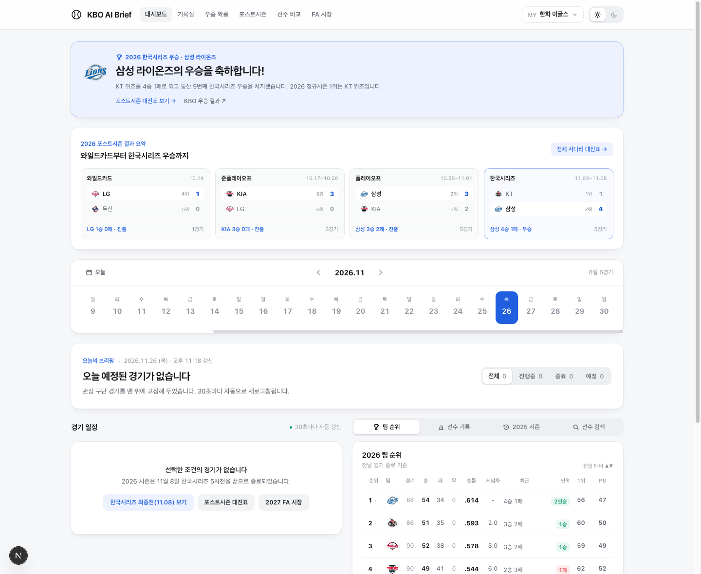
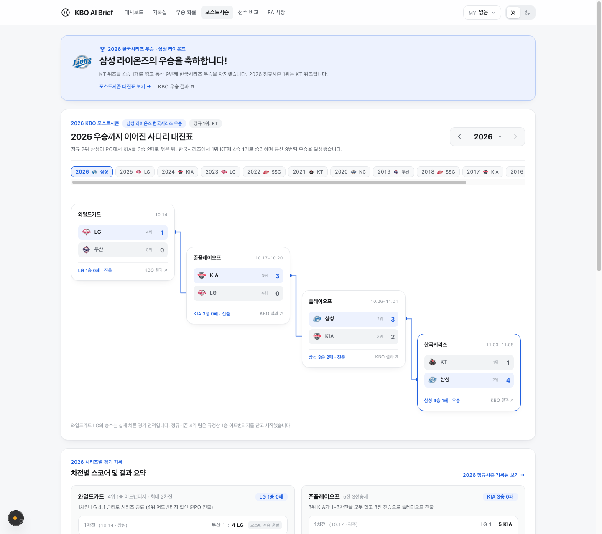
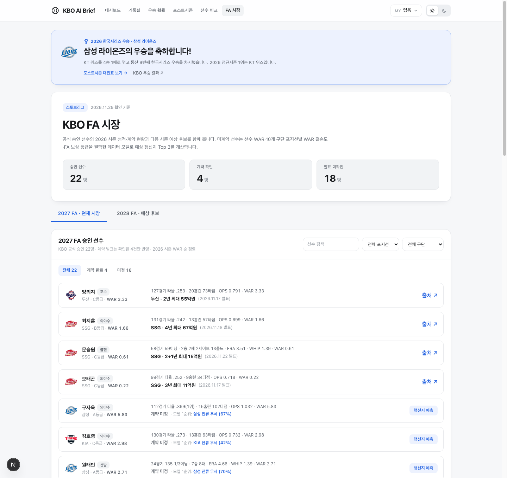
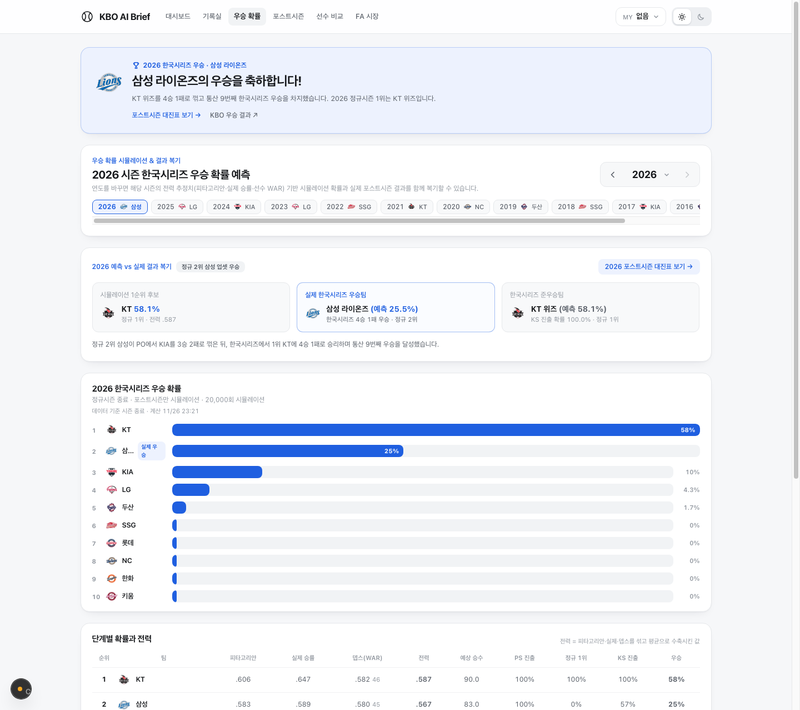
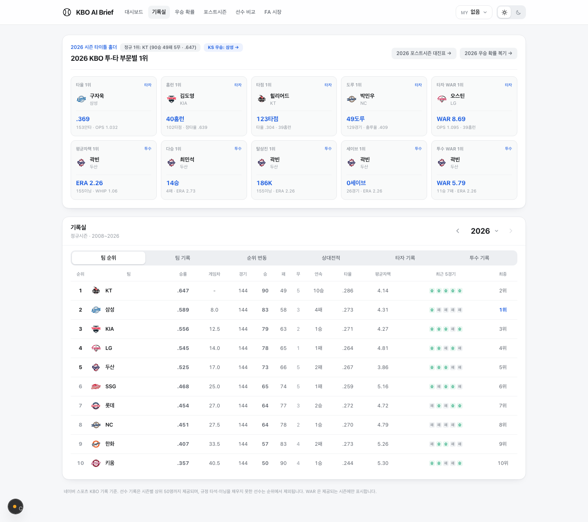
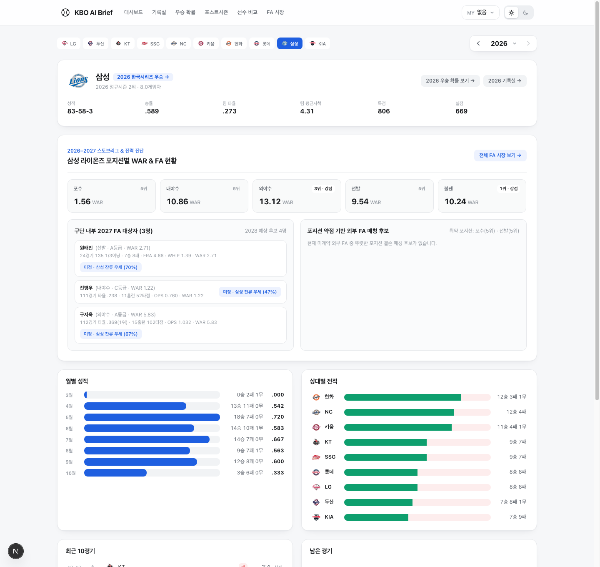
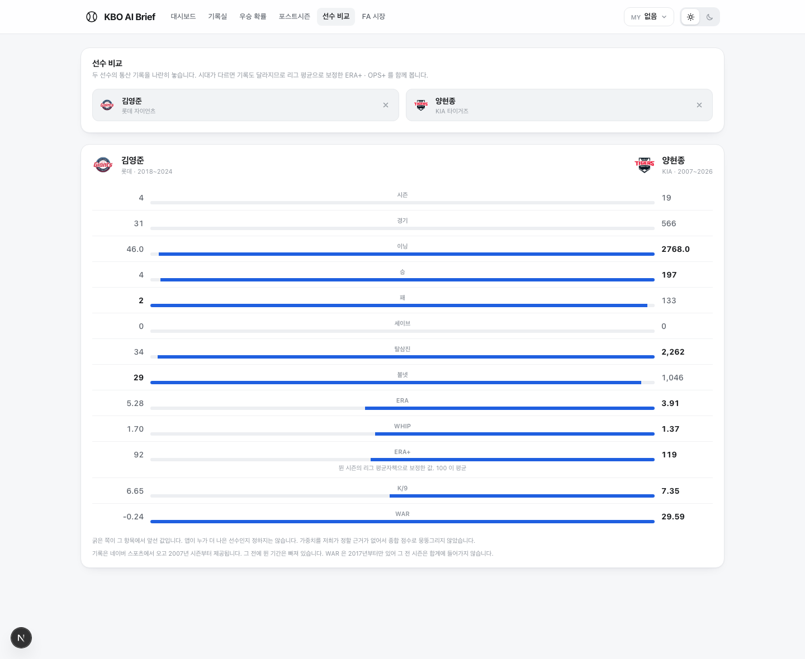
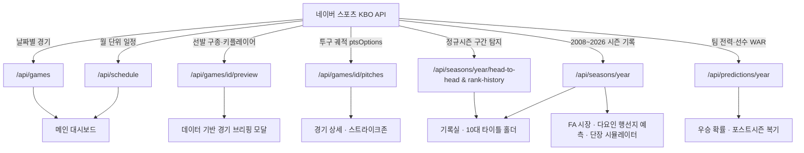

# KBO AI Brief

<p align="center">
  
  
  
  
  
</p>

KBO 리그의 경기 일정과 실시간 스코어, 팀 순위와 선수 기록, 연도별 기록실(2008~2026) 및 타이틀 홀더, 포스트시즌 12개년(2015~2026) 사다리 대진표, 우승 확률 시뮬레이션, 스토브리그 FA 시장 행선지 예측과 단장 시뮬레이터까지 한곳에서 보는 야구 데이터 분석 웹앱입니다. 데이터는 네이버 스포츠 KBO API에서 실시간으로 받아옵니다.

**배포: https://kbo-ai-brief-three.vercel.app**

> **개인 학습용 프로젝트입니다.**
>
> 이 앱은 네이버 스포츠의 **문서화되지 않은 비공개 API** 에 의존합니다. 공식 제휴나 데이터 라이선스가 없고, 네이버·KBO 와 아무 관계가 없습니다. 규격이 바뀌면 예고 없이 깨집니다.
>
> 경기 기록·순위 같은 **사실 자체는 저작권 대상이 아니지만**, 그것을 모아 만든 데이터베이스와 구단 엠블럼에는 별도의 권리가 있습니다. 그래서 **공개 서비스로 운영하거나 수익을 붙이려면 정식 데이터 라이선스가 필요합니다.** KBO 공식 기록은 스포츠투아이가 만들고 공급합니다.
>
> 선수 사진은 초상권 때문에 쓰지 않습니다. 구단 엠블럼은 각 구단의 등록상표이며 출처와 전제를 [public/teams/README.md](public/teams/README.md) 에 적어 두었습니다. `src/lib/team-assets.ts` 에서 `logo` 를 `null` 로 두면 구단 상징색 배지로 떨어집니다.
>
> 외부 API 를 부를 때 브라우저인 척하지 않습니다. `src/lib/naver.ts` 에서 앱 이름을 그대로 적은 User-Agent 를 보내고, 끝난 시즌은 30일 캐시해서 호출 자체를 줄입니다.

---

## 주요 기능 화면 쇼케이스

### 1. 메인 대시보드 (`/`) — 우승 배너 · 포스트시즌 요약 · 날짜별 일정 · 실시간 순위



- **한국시리즈 우승 축하 배너 & 포스트시즌 요약 카드**: 2026 한국시리즈 우승팀(삼성 라이온즈) 배너와 와일드카드부터 한국시리즈까지 4개 라운드 전적을 첫 화면에서 한눈에 보여줍니다.
- **월 단위 날짜 스트립 & 실시간 경기 일정**: 경기가 있는 날은 점으로 표시하고, 관심 구단(`MY 팀`)으로 설정한 구단의 경기를 최상단에 고정하며 30초마다 자동 갱신합니다.
- **우측 멀티 탭 패널**: 실시간 팀 순위(1위·포스트시즌 매직넘버 포함), 투수·타자 리더보드, 2025 시즌 성적, 1군 전체 선수 검색을 탭으로 전환합니다.

---

### 2. 포스트시즌 사다리 대진표 & 최근 12개년 아카이브 (`/postseason`)



- **사다리형 연결 그래프**: 와일드카드 → 준플레이오프 → 플레이오프 → 한국시리즈까지 승리 팀이 다음 라운드의 해당 팀 칸으로 이어지는 사다리형 대진표입니다.
- **최근 12개년(2015~2026) 연도 선택 & 아카이브 비교표**: 와일드카드 결정전이 도입된 2015년부터 2026년까지 연도를 바꾸면 해당 시즌의 대진표와 차전별 스코어·구장·주요 기록 요약으로 즉시 전환됩니다.
- **경기 상세 및 기록실 연동**: 각 차전의 `기록 →` 버튼을 누르면 해당 경기 상세 점수판(`/games/[id]`)으로, 상단 링크를 누르면 해당 연도 정규시즌 기록실(`/records?year=YYYY`)로 연결됩니다.

---

### 3. 스토브리그 FA 시장 — 다요인 행선지 예측 & 단장 영입 시뮬레이터 (`/fa`)



- **2027 FA 승인 선수 22명 & 2028 예상 후보 34명 전원 실제 성적 연동**: KBO 공시 승인 명단과 구단 공식 발표 계약 현황(기간·최대 총액·발표일·출처 링크), 그리고 선수별 2026 시즌 성적(WAR·타율/ERA·OPS/WHIP·포지션)을 함께 보여줍니다.
- **데이터 기반 행선지 적합도 Top 3 예측**: 외부 유료 LLM 호출 없이 **선수 2026 시즌 WAR + 10개 구단 5대 포지션(`포수/내야수/외야수/선발/불펜`)별 WAR 결손도 + 구단 보조 지표(ERA/OPS) + FA 등급(A/B/C) 보상 장벽**을 결합해 미계약 선수별 예상 행선지 Top 3 구단과 확률(%) 및 수치 근거를 계산합니다.
- **"내가 단장이라면" FA 영입·잔류 시뮬레이터**: 구단을 선택하고 내부 미계약 FA 잔류/이탈 및 외부 FA 영입을 체크하면 **5대 포지션별 WAR 리그 순위 변화, 144경기 환산 예상 승수 증감, 발생 보호선수(20인/25인 외) 보상 부담**을 즉시 시뮬레이션합니다.

---

### 4. 우승 확률 시뮬레이션 & 실제 포스트시즌 결과 복기 (`/predictions`)



- **20,000회 몬테카를로 시뮬레이션**: 팀별 피타고리안 승률(45%), 실제 승률(25%), 소속 선수 WAR 뎁스(30%)로 전력을 추정한 뒤 남은 정규시즌과 포스트시즌을 20,000번 시뮬레이션해 단계별(PS 진출·정규 1위·KS 진출·우승) 확률을 계산합니다.
- **연도별(2008~2026) 예측 vs 실제 한국시리즈 결과 복기**: 연도를 선택하면 해당 시즌 시뮬레이션 1순위 후보 확률과 실제 한국시리즈 우승팀·준우승팀을 나란히 대조해 모델 적중 여부와 업셋 서사를 한눈에 복기할 수 있습니다.

---

### 5. 연도별 기록실 & 투·타 10대 타이틀 홀더 쇼케이스 (`/records`)



- **투·타 10대 부문 타이틀 홀더 쇼케이스**: 2008~2026 각 시즌의 **타격 5대 타이틀(타율·홈런·타점·도루·타자 WAR/OPS 1위)**과 **투구 5대 타이틀(평균자책·다승·탈삼진·세이브·투수 WAR/WHIP 1위)** 수상자를 카드 형태로 상단에 요약합니다.
- **6개 분석 탭**: `팀 순위` · `팀 기록` · `순위 변동(일자별 선 그래프)` · `상대전적(10×10 매트릭스)` · `타자 기록` · `투수 기록`을 연도별로 제공합니다.

---

### 6. 구단 상세 페이지 — 연도별 성적 & 스토브리그 포지션 WAR 진단 (`/teams/[code]`)



- **2008~2026 연도별 구단 기록 조회**: 10개 구단 각각의 시즌별 정규시즌 성적, 포스트시즌 최종 결과 배지, 월별 승률 그래프, 상대 구단별 전적, 최근 10경기, 타자·투수 WAR 순 로스터를 한 화면에 모았습니다.
- **구단별 포지션 WAR & FA 전력 진단**: 해당 구단의 5대 포지션(`포수/내야수/외야수/선발/불펜`) WAR 합계와 리그 내 순위(강점·보강 필요 포지션), 구단 내부 2027·2028 FA 대상자, 취약 포지션 기반 외부 미계약 FA 매칭 후보를 자동 진단합니다.

---

### 7. 선수 비교 — 시대 보정(ERA+ / OPS+) 통산 기록 맞대결 (`/compare`)



- **두 선수 통산 기록 좌우 맞대결**: 2007년 이후 KBO에서 뛴 모든 선수(은퇴 선수 포함)를 검색해 통산 기록을 항목별로 비교합니다.
- **시대 보정 지표 (ERA+ / OPS+)**: 시즌마다 크게 달라지는 타고투저·투고타저 환경을 보정하기 위해 그 선수가 뛴 각 시즌의 리그 평균으로 기대 자책점·출루율·장타율을 계산해 ERA+와 OPS+(100 = 리그 평균)를 함께 제공합니다.

---

## 주요 기능 상세

### 경기 상세 — 실시간 중계 & 투구 위치(스트라이크존) (`/games/[id]`)

- **실시간 중계**: 볼카운트(B/S/O), 주자 상황 다이아몬드, 현재 투수·타자 맞대결 기록, 실시간 승리 확률, 이닝별 점수판(R·H·E·B)을 제공합니다.
- **투구 위치 (스트라이크존 SVG)**: 구장에서 측정한 투구 추적 데이터(`ptsOptions`의 3차원 릴리스 속도·가속도 벡터 및 홈플레이트 통과 좌표)로 구속(km/h)과 통과 높이(ft)를 직접 계산해 투수별 투구 분포, 최고·평균 구속, 존 통과율, 헛스윙 비율을 시각화합니다.

### 경기 브리핑 — 지어내지 않고 실제 기록만 보여준다

경기 카드의 **경기 브리핑**(경기 전) 또는 **경기 결과**(끝난 경기) 버튼을 누르면 문장을 지어내지 않고 실제 기록만 모아서 보여줍니다.

- **경기 전**: 올 시즌 상대전적, 양 팀 순위·승률·팀 타율·팀 ERA·홈런, 선발 투수 시즌 성적 및 **구종별 구사 비율과 평균 구속**, 최근 5경기 흐름, 키플레이어 비교 및 13구역 HOT/COLD ZONE
- **끝난 경기**: 최종 스코어, 이닝별 득점, R·H·E·B, 승리·패전 투수

---

## 화면과 API

| 경로 | 설명 |
| --- | --- |
| `/` | 대시보드 — 우승 축하 배너, 포스트시즌 요약 카드, 날짜 스트립, 경기 카드, 팀 순위·선수 기록 패널 |
| `/postseason?year=` | 포스트시즌 — 최근 12개년(2015~2026) 사다리형 대진표, 차전별 스코어 요약, 역대 가을야구 비교표 |
| `/fa` | FA 시장 — 2027 승인 22명·2028 예상 후보 34명 성적, 다요인 행선지 Top 3 예측, 단장 영입 시뮬레이터 |
| `/predictions?year=` | 우승 확률 — 20,000회 시뮬레이션 기반 우승 확률 예측 및 연도별 실제 포스트시즌 결과 복기 |
| `/records?year=` | 기록실 — 2008~2026 투·타 10대 타이틀 홀더 쇼케이스, 팀·선수 기록, 순위 변동 그래프, 상대전적 |
| `/teams/[code]?year=` | 구단 상세 — 2008~2026 연도별 성적, 스토브리그 포지션 WAR·FA 진단, 월별·상대별 전적, 로스터 |
| `/compare?a=&b=` | 선수 비교 — 두 선수의 통산 기록 및 시대 보정(ERA+ / OPS+) 맞대결 |
| `/players/[id]` | 선수 상세 — 연도별 기록과 통산 합계 및 시대 보정 지표 |
| `/games/[id]` | 경기 상세 — 실시간 중계, 이닝별 점수판, 타순·투수 기록, 투구 위치(스트라이크존) |

| API | 설명 |
| --- | --- |
| `GET /api/schedule?month=YYYY-MM` | 한 달치 일정 요약 (날짜별 경기 수) |
| `GET /api/games?date=YYYY-MM-DD` | 해당 날짜의 경기 목록 |
| `GET /api/games/[id]` | 경기 상세 |
| `GET /api/games/[id]/preview` | 선발 구종 비율·구속, 키플레이어, 시즌 상대전적, HOT/COLD ZONE |
| `GET /api/games/[id]/pitches?home=&away=` | 투구 추적 데이터 (투수별 위치·구속) |
| `GET /api/standings` | 현재 시즌 팀 순위 및 매직넘버 |
| `GET /api/players` | 선수 기록 리더보드 (투수·타자) |
| `GET /api/teams/[code]?year=` | 구단 상세 (연도별 월별·상대별 성적, 일정, 로스터) |
| `GET /api/players/[id]` | 선수 통산 기록 (연도별 타자·투수 성적 및 ERA+/OPS+) |
| `GET /api/players/search?q=` | 선수 검색 (`scope=career` 시 2007~2026 전체 선수 색인 검색) |
| `GET /api/seasons/[year]` | 연도별 팀·타자·투수 전체 기록 |
| `GET /api/seasons/[year]/rank-history` | 일자별 순위 (순위 변동 그래프) |
| `GET /api/seasons/[year]/head-to-head` | 연도별 팀간 상대전적 10×10 매트릭스 |
| `GET /api/predictions/[year]` | 연도별 우승 확률 20,000회 시뮬레이션 |

---

## 디자인

애플 HIG 와 토스를 레퍼런스로 삼은 밝고 정돈된 화면입니다. 색은 `src/app/globals.css` 에 CSS 변수로 한 번만 정의하고 컴포넌트는 시맨틱 클래스(`bg-surface`, `text-fg2`)만 쓰므로 모드별 분기 코드가 없습니다. 구단 엠블럼은 `src/lib/team-assets.ts` 한 곳에서 관리하고, 파일이 없으면 구단 상징색 배지로 자동으로 떨어집니다.

토큰 표, 크기 규칙, 엠블럼 교체 절차는 **[docs/DESIGN.md](docs/DESIGN.md)** 에, 에셋 출처와 라이선스는 **[public/teams/README.md](public/teams/README.md)** 에 있습니다.

---

## 데이터 출처

모든 경기·순위·선수 데이터는 네이버 스포츠 KBO API 에서 옵니다. 문서가 없는 비공개 API 라 동작을 직접 확인해 가며 쓰고 있고, 함정이 여럿 있습니다 — `?date=` 파라미터가 무시된다거나, 일정 API 가 시범경기·포스트시즌을 구분해 주지 않는다거나 하는 것들입니다. 정리한 내용은 **[docs/DATA-SOURCES.md](docs/DATA-SOURCES.md)** 에 있습니다.



---

## 만들면서 부딪힌 것들

숫자를 다루는 앱이라 "화면은 멀쩡한데 값만 조용히 틀린" 문제를 여러 번 만났습니다. 찾아낸 과정과 판단을 그대로 남겨 둡니다.

### WAR 이 2017년부터만 있어서 6개 시즌의 예측이 망가져 있었다

우승 확률 모델은 팀 전력을 피타고리안 승률 45% · 실제 승률 25% · 선수 뎁스(WAR) 30% 로 섞어 만듭니다. 그런데 네이버가 WAR 을 주는 범위를 확인해 보니 이랬습니다.

| 시즌 | 타자 WAR 합 | 투수 WAR 합 |
| :--- | ---: | ---: |
| 2008~2013 | 0.0 | 0.0 |
| 2014~2016 | 0.0 | 110~143 |
| 2017~2026 | 205~239 | 130~150 |

없는 값이 `0` 으로 오는데 그대로 쓰고 있었습니다. 그래서 2013년 이전 시즌은 열 팀의 뎁스가 전부 `0.299` 로 같아졌고, 가중치 30% 짜리 항이 팀을 구분하지 못한 채 전력 격차만 70% 로 눌렀습니다.

문제는 이미 문서에 "과거 18시즌 검증, 모델 1순위 적중 15/18" 이라고 써 둔 뒤였다는 것입니다. **그 18시즌이 사실 서로 다른 세 모델이었습니다.** 없는 값을 상수로 때우는 대신 남은 항끼리 가중치를 재정규화하도록 고치고, 검증을 뎁스가 온전한 2017~2025 9시즌으로 다시 냈습니다. 그리고 그 9시즌에서 모델의 1순위가 정규시즌 1위와 전부 같았다는 것, 즉 **이 모델이 더하는 것은 후보 선택이 아니라 확률의 크기라는 점도 문서에 적었습니다.**

### 2009년은 승률 규정이 달라서 1위가 뒤집힌다

정규시즌 순위를 `승 / (승 + 패)` 로 직접 계산하고 있었는데, 2009년이 어긋났습니다.

| 팀 | 성적 | 그해 공식 승률 | 직접 계산 |
| :--- | :--- | ---: | ---: |
| KIA | 81승 48패 4무 | **.609** | .628 |
| SK | 80승 47패 6무 | .602 | **.630** |

무승부를 승률에 넣느냐가 시대마다 달랐기 때문입니다. 실제 2009년 1위는 KIA 인데 우리 계산은 SK 를 1위로 올리고 있었습니다.

연도별로 규정을 하드코딩하는 대신, **최종 성적으로 두 규정을 모두 계산해 네이버가 준 값과 맞는 쪽을 고르게** 했습니다. 추측하지 않고 대조합니다. 매직넘버도 같은 이유로 흔히 쓰는 "상대 최대 승수 - 내 승수 + 1" 공식을 쓰지 않고 가능한 결과를 직접 따집니다.

### 필요하지도 않은 위장을 하고 있었다

모든 네이버 요청에 브라우저인 척하는 User-Agent 와 `Referer: https://sports.naver.com/` 을 붙이고 있었습니다. 우리 서버 요청을 네이버 자기 사이트에서 나간 것처럼 보이게 하는 것입니다. 정말 필요한지 확인해 봤습니다.

```
헤더 전혀 없음                              200
User-Agent 만                              200
UA + Referer 네이버                         200
kbo-ai-brief/1.0 (personal hobby project)  200
```

막혀 있지도 않은데 숨기고 있었습니다. 13개 파일에 흩어져 있던 사본을 `src/lib/naver.ts` 한 곳으로 모으고 앱 이름을 그대로 보내도록 바꿨습니다. 정직하게 보냈는데 차단되면 차단된 대로 받아들이는 편이 맞다고 봤습니다.

선수 사진도 같은 기준입니다. 네이버 CDN 두 곳 중 한 곳은 Referer 검사를 하지 않아 그냥 불러도 열리지만, **막혀 있지 않은 것과 써도 되는 것은 다르므로** 쓰지 않습니다.

### AI 라고 이름 붙인 자리에 지어낸 문장이 있었다

배포 직전에 발견했습니다. OpenAI 키가 없을 때 `[AI 분석]` 이라는 제목으로 이런 게 나오고 있었습니다.

```
치열한 접전 끝에 롯데 자이언츠의 승리로 마감되었습니다.
득점권 주자 번트 및 불펜 필승조 투입 타이밍이 빛났습니다.
→ 이상규와 나균안 모두 특유의 결정구 체인지업과 슬라이더 조합으로...
```

번트가 있었는지, 그 투수가 체인지업을 던지는지 아무것도 확인하지 않고 팀 이름과 점수만 끼워 넣은 템플릿이었습니다. 경기 목록 API 에도 같은 종류의 문장이 박혀 있었습니다.

전부 걷어내고 실제 수치로 바꿨습니다. 마침 네이버 프리뷰 응답에 **선발 투수의 구종별 구사 비율과 평균 구속**이 들어 있어서, 지어냈던 그 문장이 진짜 숫자가 됐습니다.

```
박준영  직구 49% 138km/h · 슬라이더 24% 129km/h · 체인지업 17% 121km/h
페덱    직구 35% 148km/h · 체인지업 22% 134km/h · 커터 19% 140km/h
```

`openai` 패키지와 `/api/ai-brief` 라우트는 지웠습니다. FA 행선지 예측과 단장 시뮬레이터 역시 유료 LLM이 문장을 지어내는 대신, 2026 시즌 선수 WAR와 10개 구단 포지션별 WAR 결손도·FA 보상 규정을 직접 계산해 수치 근거로 보여주는 방식을 택했습니다.

### 테스트가 실제로 뭘 잡는지 확인했다

계산 함수 91개 테스트를 쓴 다음, 통과만 하는 테스트가 아닌지 보려고 **위에서 겪은 버그들을 코드에 다시 심어 봤습니다.**

| 다시 심은 버그 | 결과 |
| :--- | :--- |
| 이닝을 `Number()` 로 파싱 (`"138 2/3"` -> NaN) | 잡힘 |
| 뎁스 없을 때 재정규화 안 하고 상수 .5 섞기 | 잡힘 |
| 2009 승률 규정 판별 빼먹기 | 잡힘 |
| 매직넘버를 승수 기준으로 (무승부 무시) | 잡힘 |

네 개 전부 빨간불이 떴습니다. 테스트 개수보다 이게 실제 값어치라고 봅니다.

---

## 로컬 실행

```bash
npm install
```

```bash
npm run dev
```

[http://localhost:3000](http://localhost:3000) 에서 확인합니다.

### 테스트

```bash
npm test          # 10개 파일 91개 단위 테스트 실행
npm run test:watch
```

계산이 맞는지 검사합니다. 네트워크를 쓰지 않아 1초 안에 끝납니다.

---

## 알려진 제약

- 데이터는 네이버 스포츠의 **비공개 API** 에 의존합니다. 규격이 바뀌면 깨질 수 있고, 서버에서 나가는 호출이라 배포 환경에 따라 차단될 수 있습니다
- 팀 기록은 2008, 선수 기록은 2007 시즌이 하한이고 그 이전은 API 가 주지 않습니다
- 구단 엠블럼은 각 구단 등록상표입니다. 수익이 붙는 서비스로 운영하려면 별도 라이선스가 필요합니다 (자세한 내용은 `public/teams/README.md`)

---

## 라이선스

MIT License
