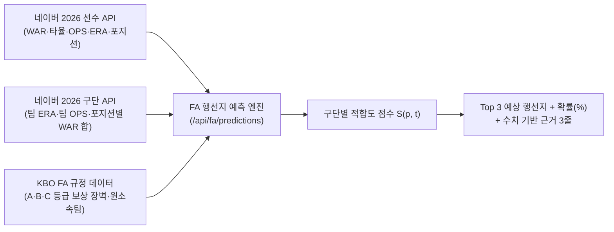

# FA 시장 행선지 예측 고도화 및 포스트시즌 대진표 홈 연동 계획서

> **작성일**: 2026-11-25  
> **목적**: FA 미계약 선수 행선지 예측 모델 설계(데이터 기반 확률 모델 vs LLM 모델 선택) 및 메인 대시보드 포스트시즌 대진표 미리보기 연동 계획 수립

---

## 1. 배경 및 현재 상태 진단

### 1-1. 현재 FA 행선지 예측 (`src/lib/fa-market.ts`)의 한계
- 현재 `predictDestination()` 함수는 선수 개인의 성적이나 포지션, 구단별 전력 불균형을 전혀 보지 않고 **"확인된 4건이 모두 잔류했으므로 모든 미계약 선수를 원소속팀 잔류(확신도: 낮음)"**로만 반환하는 단순 더미 규칙입니다.
- 반면 이 프로젝트는 이미 네이버 KBO 2026 시즌 API를 통해 **전체 선수 650여 명의 세부 성적(WAR, OPS, ERA, 이닝, 포지션)**과 **10개 구단의 투·타 세부 지표 및 포지션별 WAR 로스터**를 실시간으로 가져올 수 있습니다.

### 1-2. 이 프로젝트의 핵심 원칙과의 정합성
- 앞서 `docs/DEPLOYMENT.md`와 `docs/PLAN.md` 9번 항목에서 확립한 원칙:
  1. **근거 없는 문장 생성(Hallucination) 금지**: 확인되지 않은 사실을 AI가 그럴듯하게 지어내지 않고 실제 기록과 수치로 말한다.
  2. **클라우드 배포 시 API 과금 방어**: 공개 배포된 Vercel 환경(`https://kbo-ai-brief-three.vercel.app`)에 유료 LLM API 키(`OPENAI_API_KEY`)를 두면 누구나 호출해 과금이 발생할 수 있어 제거한 상태다.

---

## 2. 어떤 AI / 예측 모델을 쓸 것인가? (모델 선택안)

FA 행선지 예측에 사용할 모델은 아래 **두 가지 방식** 중 선택할 수 있으며, 이 프로젝트의 기존 우승 확률 예측(`docs/PREDICTION.md`) 철학과 배포 비용 제약을 고려할 때 **방식 A(데이터 기반 다요인 적합도 스코어링 모델)를 기본 엔진으로 탑재**하는 것을 권장합니다. 원하실 경우 **방식 B(사전 생성형 LLM 리포트)**를 결합할 수 있습니다.

### [권장] 방식 A — 통계·규칙 기반 다요인 적합도 모델 (Multi-Factor Utility Scoring Model)
- **개요**: 외부 유료 LLM 호출 없이, 네이버 KBO API의 **실제 2026 시즌 선수 기록 + 10개 구단 포지션별 WAR 공백 + KBO FA 등급별 보상 규정**을 결합해 각 선수의 **상위 3개 예상 행선지 구단과 적합도 확률(%)**을 계산하는 방식입니다.
- **장점**:
  - API 비용 0원, Vercel 배포 환경에서 즉시 실시간 동작
  - 왜 그 구단이 1순위/2순위인지 **정량적 수치 근거(선수 2026 WAR, 해당 구단의 포지션 평균 대비 WAR 열세, FA 등급 보상 장벽)**를 100% 투명하게 제시 가능
  - 지어낸 문장이 전혀 없으며 프로젝트의 우승 확률 시뮬레이션(`src/lib/prediction.ts`)과 일관된 데이터 사이언스 철학 유지

### [선택 결합] 방식 B — LLM 기반 심층 스토브리그 리포트 (빌드 시점 사전 생성 / 캐싱)
- **개요**: 런타임에 사용자가 버튼을 누를 때마다 LLM API를 호출하는 대신, 미계약 FA 18명에 대해 **방식 A의 실제 수치 데이터를 프롬프트 컨텍스트로 고정 주입**하여 LLM이 작성한 분석 코멘트를 정적 JSON 스냅샷으로 저장해 두는 방식입니다.
- **사용 가능한 LLM 모델 후보** (방식 B 채택 시):
  1. **OpenAI `gpt-4.1-mini` 또는 `gpt-4o-mini`**: 구조화된 JSON 출력(Structured Outputs)과 한국어 야구 도메인 요약에 강하며, 18명 일괄 사전 생성 시 비용이 10원 미만으로 사실상 무료이고 배포 서버에는 API 키를 넣을 필요가 없음.
  2. **Google `gemini-2.5-flash`**: 무료 티어 제공 및 빠른 한국어 요약 가능.
- **권장 결론**:
  - **1순위 추천**: **방식 A 단독 (순수 데이터 기반 다요인 확률 모델)** — 앞서 `/api/ai-brief`를 걷어내고 실제 데이터 브리핑으로 통일한 프로젝트 방향성과 가장 잘 맞습니다.
  - **2순위 추천**: **방식 A(수치·확률 계산) + 로컬에서 1회 생성해 고정한 LLM 코멘트 스냅샷** — 배포 환경에 API 키를 노출하지 않으면서도 자연어 해설을 함께 제공할 수 있습니다.

---

## 3. FA 행선지 예측 알고리즘 상세 설계 (방식 A 기준)

미계약 FA 선수 $p$에 대해 10개 구단 $t \in \{1..10\}$ 각각의 **영입 매력도 점수 $S(p, t)$**를 아래 4가지 실제 데이터 요인의 가중합으로 계산한 뒤, Softmax 정규화를 거쳐 **Top 3 예상 구단과 확률(%)**을 산출합니다.

### 요인 1. 선수 2026 시즌 가치 ($V_p$)
- 네이버 선수 API(`/statistics/categories/kbo/seasons/2026/players?pageSize=500`)에서 해당 FA 선수의 2026 실적을 매칭합니다.
- **주요 노출 지표**:
  - 타자: `경기`, `타율`, `홈런`, `타점`, `OPS`, `WAR`, 세부 포지션(`포수`/`내야수`/`외야수`)
  - 투수: `경기`, `이닝`, `ERA`, `승-패-세이브-홀드`, `WHIP`, `WAR`, 역할(`선발`/`불펜` — 이닝 및 세이브·홀드 비중으로 판별)

### 요인 2. 구단별 포지션 수요 점수 ($N(p, t)$, 가중치 40%)
- 10개 구단별로 해당 포지션의 2026 시즌 전력 열세를 측정합니다.
  - **포수 / 내야수 / 외야수**: 각 구단 소속 해당 포지션 선수들의 2026 WAR 합계와 공격 지표(`offenseOps`)를 리그 평균과 비교합니다. 리그 평균보다 해당 포지션 WAR가 낮을수록 수요 점수 $N(p, t)$가 높아집니다.
  - **선발 투수 / 불펜 투수**: 각 구단의 팀 평균자책점(`defenseEra`), 팀 WHIP(`defenseWhip`), 투수진 WAR 합계를 리그 평균과 비교합니다. 마운드 지표가 취약한 구단일수록 투수 FA 수요 점수가 올라갑니다.

### 요인 3. 원소속팀 잔류 프리미엄 및 프랜차이즈 가중치 ($R(p, t)$, 가중치 35%)
- KBO FA 시장의 역사적 특성 및 올해 초기 계약 추세(발표된 4건 모두 잔류)를 반영해 원소속팀($t = t_{\text{orig}}$)에 기본 잔류 가산점을 부여합니다.
- 특히 팀 내 핵심 WAR 비중을 차지하는 주전 선수일수록 원소속팀이 놓쳤을 때의 전력 손실이 크므로 원소속팀의 잔류 유인이 함께 상승합니다.

### 요인 4. KBO FA 등급별 보상 장벽 페널티 ($G(p, t)$, 가중치 25%)
- 타 구단($t \neq t_{\text{orig}}$) 이적 시 KBO FA 등급 규정에 따른 영입 장벽을 반영합니다:
  - **A등급** (보호선수 20인 외 1명 + 전년도 연봉 200% 또는 연봉 300%): 타 구단 영입 페널티 높음 (단, 선수 WAR가 리그 최상위권인 경우 빅마켓·상위권 구단은 감수 가능)
  - **B등급** (보호선수 25인 외 1명 + 연봉 100% 또는 연봉 200%): 중간 페널티
  - **C등급** (보상선수 없음, 전년도 연봉 150%만 보상): 타 구단 이적 페널티 없음 → **포지션 수요가 높은 타 구단 이적 시나리오가 가장 활발하게 열림**

### 출력 결과 형태 (화면 표시)
- 미계약 선수의 `행선지 예측` 클릭 시 단순 1개 팀이 아니라 아래 정보를 카드로 표시합니다:
  1. **선수 2026 시즌 성적 요약 배지**: 예) `2026 시즌 · 140경기 타율 .312 22홈런 OPS .895 WAR 4.82`
  2. **예상 행선지 Top 3 확률 바**:
     - `1순위: 원소속팀 잔류 (58%)`
     - `2순위: ○○ (포지션 보강 유력, 24%)`
     - `3순위: △△ (뎁스 보강 후보, 18%)`
  3. **수치 기반 근거 리스트**:
     - 선수의 2026 시즌 리그 내 위치 (WAR 및 핵심 지표)
     - 2·3순위 타 구단이 뽑힌 실제 데이터 근거 (예: *"○○ 구단은 2026 시즌 외야수 합산 WAR가 리그 8위(3.1)로 외야 보강 수요가 높음"*)
     - FA 등급(A/B/C)에 따른 보상선수 발생 여부와 이적 난이도

---

## 4. 포스트시즌 추가 고도화 및 대시보드 홈 연동 계획

### 4-1. 메인 대시보드(`/`)에 포스트시즌 대진표 미리보기 연동
- **배경**: 현재 시즌이 종료된 비시즌(11월)이라 대시보드 첫 화면(`src/app/page.tsx`)의 왼쪽 경기 일정 영역에 `"선택한 조건의 경기가 없습니다"`가 먼저 보이고, 오른쪽 탭에는 `팀 순위 / 선수 기록 / 2025 시즌 / 선수 검색`만 있습니다.
- **개선 내용**:
  1. **대시보드 우측 탭 또는 상단 요약 섹션에 `2026 포스트시즌` 미니 대진표 카드 추가**:
     - 와일드카드(LG 1-0 두산) → 준PO(KIA 3-0 LG) → PO(삼성 3-2 KIA) → 한국시리즈(삼성 4-1 KT) 흐름을 한눈에 볼 수 있는 컴팩트 스텝 뷰(Compact Ladder Preview)를 제공하고, 클릭 시 `/postseason` 전체 사다리 대진표로 이동합니다.
  2. **비시즌 대시보드 안내 개선**:
     - 선택한 날짜에 경기가 없을 때 단순 빈 화면 대신 **"2026 시즌이 한국시리즈(11.08)로 종료되었습니다"** 안내와 함께 **한국시리즈 최종전 날짜로 바로 이동**하거나 **포스트시즌 대진표(`/postseason`) / FA 시장(`/fa`)**으로 바로 이동하는 빠른 액션 버튼을 제공합니다.

### 4-2. 포스트시즌 대진표(`/postseason`) 시리즈별 상세 정보 보강
- 각 시리즈 카드(와일드카드, 준PO, PO, 한국시리즈)에서 승패 숫자뿐 아니라 **시리즈 MVP / 결정적 경기 스코어 요약(예: 1~5차전 경기별 결과 한 줄)**을 함께 펼쳐볼 수 있도록 보강합니다.

---

## 5. 구현 파일 및 작업 순서 (완료 기록)

- [x] **1단계 — FA 시장 다요인 행선지 예측 엔진 및 2026 성적 연동 (`bb86365`)**
  - `src/lib/fa-market.ts` & `src/app/fa/page.tsx`: 유료 LLM API 호출 없이 네이버 2026 시즌 선수 성적(타자 359명·투수 293명 WAR·OPS·ERA·포지션) + 10개 구단 포지션별(`포수/내야수/외야수/선발/불펜`) WAR 결손도 + KBO FA 등급(A/B/C) 보상 규정을 결합해 Top 3 예상 행선지 구단과 적합도 확률(%) 산출
  - 2027 FA 승인 선수 22명 및 2028 예상 후보 34명 전원 2026 시즌 실제 성적 배지 및 선수 상세 페이지(`/players/[id]`) 링크 연결
  - 10개 구단 포지션별 WAR 분포표를 FA 화면 하단에 공개하여 예측 근거 투명성 확보
- [x] **2단계 — 메인 대시보드 포스트시즌 미리보기 연동 및 비시즌 빠른 이동 (`bb86365`)**
  - `src/components/PostseasonPreviewCard.tsx` & `src/app/page.tsx`: 홈 화면 상단에 4개 시리즈 요약 미리보기 카드 연동 및 비시즌 빈 경기 화면에서 한국시리즈 최종전(11.08)·포스트시즌 대진표·FA 시장 빠른 이동 액션 추가
- [x] **3단계 — 최근 12개년(2015~2026) 연도별 포스트시즌 사다리 대진표 및 아카이브 (`d208a18`)**
  - `src/lib/postseason-2026.ts` & `src/components/PostseasonBracket.tsx` & `src/app/postseason/page.tsx`: 와일드카드 결정전이 도입된 2015년부터 2026년까지 12개 시즌 전체 포스트시즌 시리즈 대진·승패·차전별 스코어 수록
  - 연도 선택기(`◀ 2026 ▶`)·우승팀 빠른 선택 칩·12개년 가을야구 라운드별 결과 비교표 및 차전별 경기 상세(`/games/[id]`) 연동
- [x] **4단계 — 우승 확률 예측(`/predictions`) 연도 선택 및 실제 포스트시즌 결과 복기 연동 (`22cb96d`)**
  - `src/app/predictions/page.tsx` & `src/components/predictions/ChampionshipOdds.tsx`: 2008~2026 전 시즌 연도 선택기 추가 및 2015~2026 포스트시즌 실제 우승·준우승 결과와 시뮬레이션 예측 확률을 한 화면에서 대조·복기하는 `PostseasonReviewBanner` 구현
- [x] **5단계 — 구단 상세 페이지(`/teams/[code]`) 연도 선택기 및 스토브리그(FA·포지션별 WAR 약점 진단) 통합**
  - `src/app/teams/[code]/page.tsx`: 2008~2026 시즌 선택기(`◀ 2026 ▶`) 및 해당 시즌 포스트시즌 최종 성적 배지 연동
  - 구단별 5대 포지션(`포수/내야수/외야수/선발/불펜`) WAR 리그 순위 진단, 내부 2027·2028 FA 대상자 현황, 취약 포지션 기반 외부 미계약 FA 매칭 후보를 한눈에 보여주는 `TeamStoveLeagueSection` 추가
- [ ] **다음 예정 단계 — FA 영입 시뮬레이터 ("내가 단장이라면" 구단 WAR·예상 승수 변화 계산기) 및 기록실 타이틀 홀더 쇼케이스**
